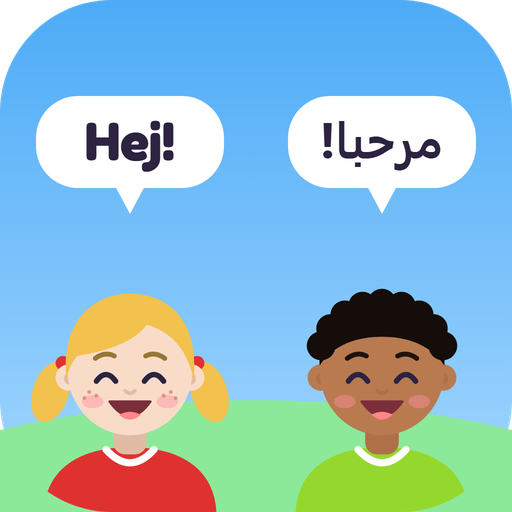

# Language Friends (LanguageFriends)


[](LICENSE)
[](https://github.com/kreaton/LanguageFriends/stargazers)

⭐ If Language Friends earns a place on your machine, [star it on GitHub](https://github.com/kreaton/LanguageFriends) — it's free, made by one developer, and stars are how other people find it.



**A language game where kids teach kids: hear a letter, a word or a number in another language and tap the right one.**

▶️ **Play it:** <https://kreaton.github.io/KidsGames/languagefriends/>

The main idea is to help immigrant children learn Danish, and to let Danish children hear and play with the languages of their classmates. There are 16 languages, each with its own cartoon kid. The kid of the language you are learning says the question; your own kid helps by saying it in your language.

It is a Blazor WebAssembly app (.NET 10) that runs entirely in the browser, with no server or backend. In Danish the game is also called *Sprogvenner*.

## How to play

1. **Who are you?** Tap the kid who speaks your language. Every kid says hello in their own language.
2. **What do you want to learn?** Tap the kid whose language you want to learn. Freja (Danish) is marked. From here on, the game's buttons and texts are in your own language.
3. Pick a **level** and a **game**.

| Game | You hear… | You tap… |
|---|---|---|
| 🔤 **Letters** | A letter of the language you are learning | The letter in its whole alphabet (right to left for Arabic) |
| 🐱 **Words** | A word, such as *kat* | The right picture (emoji) |
| 🔢 **Numbers** | A number from 1 to 10 | The number in a row of 1–10 |

A round is 10 questions. The teacher kid says the question; tap their 🔊 to hear it again. Your own kid has the same 🔊 button, which says it in your language. For a letter your alphabet doesn't have (Ø for a Ukrainian child, for example), that button is greyed out, and tapping it makes the kid shrug and say so.

A right answer plays a little "ding-ding", both kids cheer, the teacher shows "Flot!" (or "Bravo !", "Молодець!" …), your own kid says the word in your language (unless you already tapped your 🔊 for that question), and the answer is shown in both languages. A wrong answer plays a soft "boop-boop": the teacher says "Try again!" in their language and your kid says it in yours. After two misses the right tile starts to glow.

The dots at the top show the round: ⭐ right first time, 🟢 right with a miss. At the end there are 1–3 stars (10 of 10 first time is 3, 7 or more is 2, finishing is always 1). The best stars for each language pair, game and level are remembered in the browser and shown on the game buttons.

### Levels

The level decides how much is written on the screen:

| Level | Letters | Words | Numbers |
|---|---|---|---|
| ⭐ **See and hear** | The letter is shown; the tiles are in alphabet order with the lower-case letter under each | The word is shown in both languages; 3 pictures | The number word is shown in both languages and under each tile |
| ⭐⭐ **Read and hear** | Only heard; tiles in order | The word is shown only in the language being learned; 6 pictures | The number word only in the language being learned |
| ⭐⭐⭐ **Just listen** | Only heard; tiles shuffled | Only heard; 9 pictures | Only heard; tiles shuffled |

The answer is always written in both languages once it has been found.

### The kids

| Language | Kid | Language | Kid |
|---|---|---|---|
| Danish | Freja | Polish | Kuba |
| English (UK) | Oliver | Ukrainian | Софійка (Sofiika) |
| Swedish | Elias | Romanian | Andrei |
| Norwegian | Nora | Bulgarian | Мила (Mila) |
| French | Léa | Turkish | Emir |
| Spanish | Mateo | Arabic (Lebanon) | ليلى (Layla) |
| Italian | Giulia | Arabic (Standard) | عمر (Omar) |
| Dutch | Daan | German | Mia |

The kids are drawn as SVG in code ([`Components/Kid.razor`](src/LanguageFriends/Components/Kid.razor)) from a few settings each: skin, hair colour and style, shirt, and an accessory such as glasses, a beanie or a flower crown ([`Models/Languages.cs`](src/LanguageFriends/Models/Languages.cs)). They have four moods: idle (gently bobbing and blinking), talking, happy (jumping with their arms up) and oops (a little head shake).

The 🔔 button turns the small effect sounds on and off. The spoken letters, words and numbers always play, because they are the game.

## Data and sound

Everything comes from the **Audio** project (`repos2026-2\Audio`): the CSV files and the MP3s that WordAudioGenerator made with edge-tts (the female voice of each language).

| Source in Audio | Used for |
|---|---|
| `alphabets.csv` | The letters of each language, in order |
| `numbertext_selected.csv` | The numbers 1–10 written out |
| `dictionary.csv` | The 83 picture words: emoji and the word in every language |
| `speech_voices.csv` | The list of languages |
| `outputaudio/<language>/{alphabet,numbers,dictionary}/*_female.mp3` | The spoken letters, numbers and words |

[`tools/build_data.py`](tools/build_data.py) checks that every letter, number and word has its MP3, then writes `wwwroot/data/friends.json` and copies the sounds to `wwwroot/audio/<language>/alphabet/A01.mp3`, `numbers/N01.mp3` and `dictionary/D001.mp3` (about 24 MB, 1,975 files). Run it again after the Audio project changes:

```powershell
python -X utf8 tools/build_data.py ..\..\..\Audio
```

The number sounds are the voice reading the digits, so the written number words must match what it says. `NUMBER_FIXES` in `build_data.py` shows Danish 1 as *en*, as the voice says it, instead of the CSV's CLDR form *et*.

To drop a picture word from one language, for example because its recording is wrong, add it to `SKIP_WORDS` in `build_data.py`, written as in that language's column of `dictionary.csv`, and run the script again. A round then never uses the word (as question or as wrong picture) when that language is either of the two; other language pairs still have it. Its text and current recording stay in the data, marked `"skip"`, so **Check language** can still show and play it. Danish *rose* 🌹 (D063) and *fly* ✈️ (D070) are skipped this way, because the Danish voice gets them wrong; they need new recordings.

### Check language

The data and the recordings have not been checked by native speakers yet. The **🔍 Check language** button at the top of the page opens a pane for doing that. Pick a language and **Alphabet**, **Pictures** or **Numbers**, then step through every item with ⏮ ▶ ⏭ (or ← → and space; Esc closes). Each step plays the recording and shows:

- the internal number of the recording: `A01` for the first letter, `N01` for the number 1, `D063` for word 063 in `dictionary.csv`, and the file it came from in the Audio project (`outputaudio/da-DK/dictionary/D063_female.mp3`)
- the letter (with its lower case), the number with its number word, or the picture with the word, plus the English and Danish word for comparison
- a warning on words left out with `SKIP_WORDS`, and a note on number words changed with `NUMBER_FIXES`

Changing the language keeps the same item, so one word can be compared across languages. The slider jumps anywhere in the list. The pane is in English, because it is meant for the grown-ups checking the data.

The game's own texts (the buttons, "Try again!", "Well done!", the greetings) are in [`Models/Languages.cs`](src/LanguageFriends/Models/Languages.cs), written by hand. **A native speaker should check them**, like the word translations in the Audio project.

The voices are synthetic, and Microsoft requires that users are told so: the game says it at the bottom of the page, in the child's language. The audio files may only be used in the game; see [THIRD-PARTY-NOTICES.md](THIRD-PARTY-NOTICES.md) and `wwwroot/audio/README.txt`.

## Project layout

```
LanguageFriends.slnx
art/icon.svg                     The app icon: Freja and Omar saying hello
src/LanguageFriends/
  Components/Game.razor          The screens: pick languages, menu, playing, round done
  Components/Kid.razor           The cartoon kid (SVG) and its moods
  Components/LanguageCheck.razor The Check language pane: step through and hear every letter, number and word
  Models/Languages.cs            The 16 languages: kid, look, greetings and the game's texts
  Models/Language.cs, Kid.cs, UiText.cs
  Services/Round.cs              The rules: questions, levels, choices, score and stars
  Services/GameData.cs           Loads data/friends.json and knows where each sound is
  Services/SoundService.cs       Speech and the little success / try-again sounds
  Services/Settings.cs           Remembers languages, level, sound and best stars (localStorage)
  wwwroot/
    index.html, css/app.css
    js/friends.js                  Plays the MP3s, makes the effect sounds with Web Audio, localStorage
    data/friends.json              Written by tools/build_data.py
    audio/                       Spoken letters, numbers and words (synthetic voice, not MIT)
    icons/                       App icons, made by tools/make_icons.py
tools/build_data.py              Builds data/friends.json and copies the audio from the Audio project
tools/make_icons.py              Renders art/icon.svg to the PNG icons (Edge headless + Pillow)
```

## Running locally

Requires the [.NET 10 SDK](https://dotnet.microsoft.com/download) (or newer).

```powershell
dotnet run --project src/LanguageFriends
```

Then open http://localhost:53008.

## Publishing

Pushing to `main` builds the app and puts it in the `languagefriends/` folder of the KidsGames GitHub Pages site (<https://kreaton.github.io/KidsGames/languagefriends/>) with [`.github/workflows/deploy.yml`](.github/workflows/deploy.yml). It needs the repository secret `PAGES_DEPLOY_KEY`: the private half of a deploy key with write access to `kreaton/KidsGames`.

The app is served from a `languagefriends` sub-path: `<base href>` in [`wwwroot/index.html`](src/LanguageFriends/wwwroot/index.html) is `languagefriends`. The front page card is in `KidsGames/index.html`; `python -X utf8 tools/make_icons.py --front-page ..\KidsGames\billeder` copies the icon there.

## License & Authorship

This project is distributed under the terms of the [MIT License](LICENSE), except the files listed as not covered in [THIRD-PARTY-NOTICES.md](THIRD-PARTY-NOTICES.md): the spoken letters, words and numbers in `wwwroot/audio/`.

**AI authorship note:** Most of the source code in this repository was generated with AI coding agents (Claude Code), under my direction and review. Purely AI-generated material may not be eligible for copyright protection in some jurisdictions. To the extent any part of this project is protected by copyright, it is licensed under the MIT License, and the license's warranty and liability disclaimers apply to the project as a whole.

<!-- notices:start -->
### Independent development

Language Friends is an independent, personal project developed by Per Hejndorf. It is not affiliated with, endorsed by or sponsored by Microsoft, the Unicode Consortium or any other rights holder (including Google). Product names and logos are trademarks of their respective owners and are used only to identify the services and tools the project works with.

### Third-party notices and asset provenance

[THIRD-PARTY-NOTICES.md](THIRD-PARTY-NOTICES.md) lists every third-party library, font, data source and online service the project uses, with licence and source. It also records where the icons and audio came from and how they are licensed. The audio is not covered by the MIT License; [THIRD-PARTY-NOTICES.md](THIRD-PARTY-NOTICES.md) states its terms.
<!-- notices:end -->
